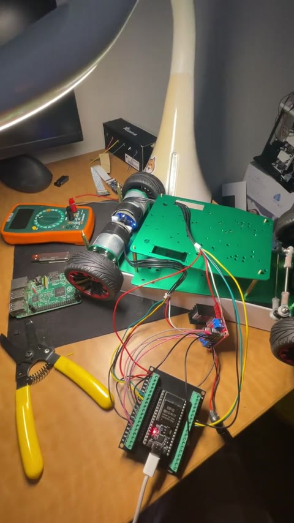

# autonomous-car-

## Progress

### Commit 1 — rear motors + encoders ([`3eb7616`](https://github.com/Ph1so/autonomous-car-/commit/3eb7616))

Both rear wheels can spin forward and in reverse, and the wheel encoders track the spin.

*Click the image to watch the video.*
