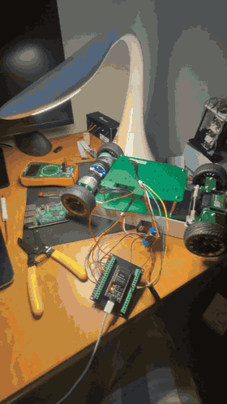
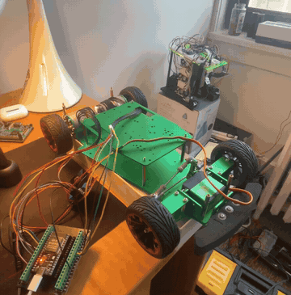

# autonomous-car

## Goal

Build an autonomous car with a LiDAR, a camera, an IMU, and two drive motors with encoders, then use it for autonomous navigation. The project brings together several core robotics ideas, including:

- Motion planning for exploration
- Localization and mapping

## Current status

Hardware in use so far:

- Car chassis (got it for free :)) )
- 2 drive motors with attached encoders
- L298N motor controller
- ESP32
- Steering servo

The car is currently powered by a wall-plug power supply.

## Next steps

- [ ] Buy an onboard power supply so the car doesn't need to be plugged into the wall
- [x] Wire up the steering servo and make sure it works
- [ ] 3D print a plate for the top of the chassis so the Raspberry Pi, ESP32, motor controller, etc. sit snugly

## Progress

### Commit 1 — rear motors + encoders ([`3eb7616`](https://github.com/Ph1so/autonomous-car/commit/3eb7616))

Both rear wheels can spin forward and in reverse, and the wheel encoders track the spin.

### Commit 2 — steering servo ([`84c9bc5`](https://github.com/Ph1so/autonomous-car/commit/84c9bc5))

The steering servo is wired to the ESP32 and turns the front wheels left and right. The car can now be driven and steered with serial commands, and it runs a preflight check that sweeps the steering while driving forward and in reverse.

