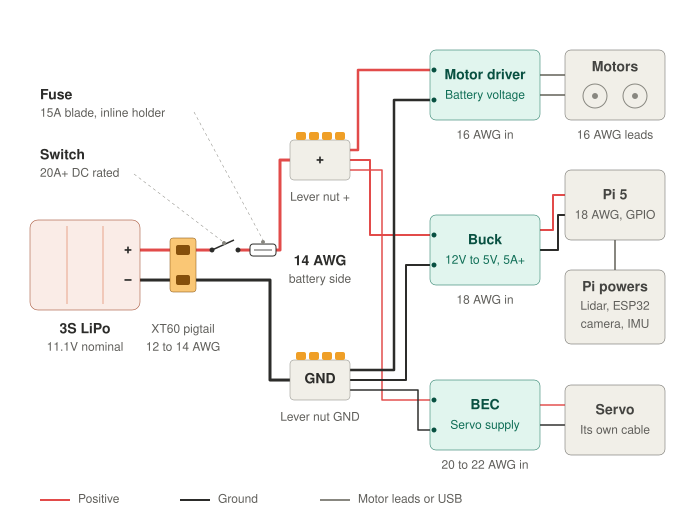
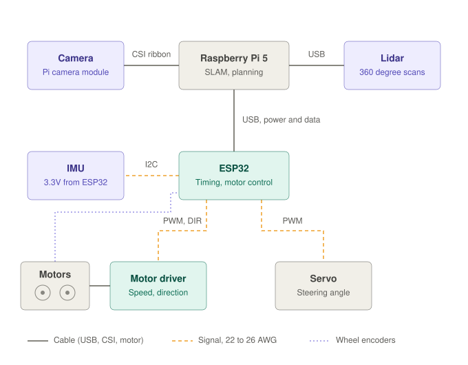

# autonomous-car

## What it does right now

- Drives both rear wheels forward and in reverse
- Tracks each wheel with its encoder
- Steers the front wheels with a servo
- Takes drive and steering commands over serial and prints live telemetry
- Runs a preflight self-test and scripted test drives (straight, circle, figure eight)
- No sensors or autonomy yet. The car is currently powered by a wall-plug power supply.

## Goal

Build an autonomous car with a LiDAR, a camera, an IMU, and two drive motors with encoders, then use it for autonomous navigation. The project brings together several core robotics ideas, including:

- Motion planning for exploration
- Localization and mapping

## Parts list

See [docs/hardware.md](docs/hardware.md).

## Wiring

Power, from the battery to every part.

Signal and data, showing how the Pi, ESP32, and sensors talk to each other.

## Next steps

- [ ] Buy an onboard power supply so the car doesn't need to be plugged into the wall
- [x] Wire up the steering servo and make sure it works
- [ ] 3D print a plate for the top of the chassis so the Raspberry Pi, ESP32, motor controller, etc. sit snugly

## Progress

### Oct 22, 2026 — rear motors + encoders ([`3eb7616`](https://github.com/Ph1so/autonomous-car/commit/3eb7616))

Both rear wheels can spin forward and in reverse, and the wheel encoders track the spin.

https://github.com/user-attachments/assets/619cad2e-01a0-4b4f-825d-e00940ae4f94

### Oct 23, 2026 — steering servo ([`dff47ca`](https://github.com/Ph1so/autonomous-car/commit/dff47ca))

The steering servo is wired to the ESP32 and turns the front wheels left and right. The car can now be driven and steered with serial commands, and it runs a preflight check that sweeps the steering while driving forward and in reverse.

https://github.com/user-attachments/assets/e2327bac-70e3-4597-b05d-988a0bba1404
