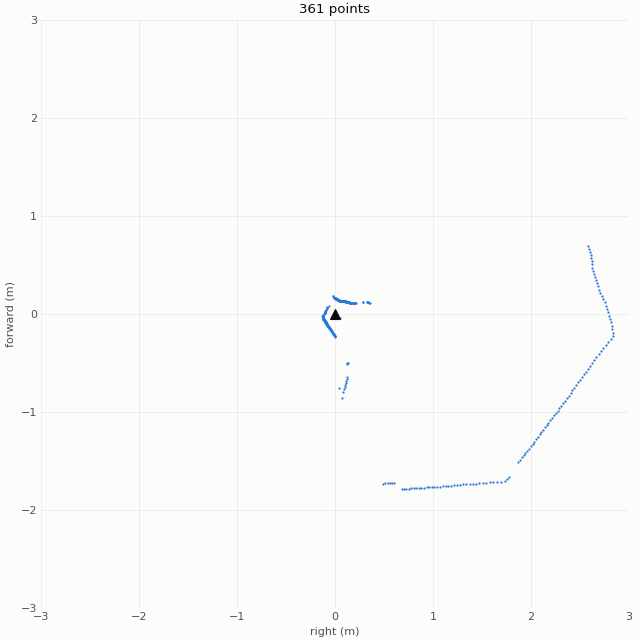

# autonomous-car

## What it does right now

- Drives both rear wheels forward and in reverse
- Tracks each wheel with its encoder
- Steers the front wheels with a servo
- Takes drive and steering commands over USB serial or Bluetooth and prints live telemetry
- Stops the motors if no command arrives for 1 second
- Runs a preflight self-test and scripted test drives (straight, circle, figure eight)
- Runs entirely on its onboard 3S LiPo battery
- Reads 360° scans from the RPLIDAR C1 and shows them live as a top-down plot (on my laptop for now)
- No autonomy yet

## Goal

Build an autonomous car with a LiDAR, a camera, an IMU, and two drive motors with encoders, then use it for autonomous navigation. The project brings together several core robotics ideas, including:

- Motion planning for exploration
- Localization and mapping

## Parts list

See [docs/hardware.md](docs/hardware.md).

## Wiring

Power, from the battery to every part.


Signal and data, showing how the Pi, ESP32, and sensors talk to each other.


## Code

Clone with the Slamtec SDK submodule:

```sh
git clone --recurse-submodules https://github.com/Ph1so/autonomous-car.git
```

If you already cloned without it, run `git submodule update --init` inside the repo.

- `firmware/racecar/`: ESP32 sketch for the drive motors, encoders, steering, and USB/Bluetooth commands. Arduino needs the folder name to match `racecar.ino`.
- `tools/`: laptop-side scripts, like `lidar_view.py`, a live top-down plot of lidar scans
- `slam/`: mapping and localization (empty for now)
- `third_party/rplidar_sdk/`: Slamtec's RPLIDAR SDK, as a git submodule
- `docs/`: parts list and wiring diagrams
- `media/`: demo videos and GIFs

Build, upload, and run commands are in [usage.md](usage.md).

## Next steps

- [x] Buy an onboard power supply so the car doesn't need to be plugged into the wall
- [x] Wire up the steering servo and make sure it works
- [ ] 3D print a plate for the top of the chassis so the Raspberry Pi, ESP32, motor controller, etc. sit snugly

## Progress

### Oct 22, 2026 — rear motors + encoders ([`3eb7616`](https://github.com/Ph1so/autonomous-car/commit/3eb7616))

Both rear wheels can spin forward and in reverse, and the wheel encoders track the spin.

https://github.com/user-attachments/assets/619cad2e-01a0-4b4f-825d-e00940ae4f94

### Oct 23, 2026 — steering servo ([`dff47ca`](https://github.com/Ph1so/autonomous-car/commit/dff47ca))

The steering servo is wired to the ESP32 and turns the front wheels left and right. The car can now be driven and steered with serial commands, and it runs a preflight check that sweeps the steering while driving forward and in reverse.

https://github.com/user-attachments/assets/e2327bac-70e3-4597-b05d-988a0bba1404

### Oct 28, 2026 — battery power, Bluetooth, and lidar ([`905fb50`](https://github.com/Ph1so/autonomous-car/commit/905fb50), [`088c1e6`](https://github.com/Ph1so/autonomous-car/commit/088c1e6))

The car now runs on its 3S LiPo and takes drive and steering commands over Bluetooth, stopping the motors if no command arrives for 1 second. The RPLIDAR C1 streams scans to my laptop through Slamtec's SDK, and `tools/lidar_view.py` plots each rotation live from above.


